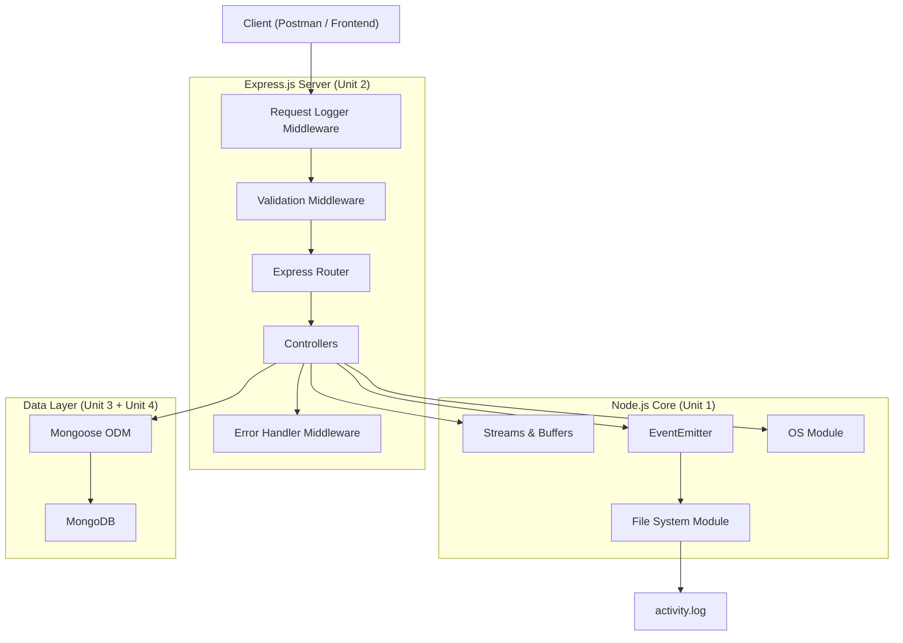

# RecallMind — Product Requirements Document (PRD)

> **Read it once, actually remember it.**

---

## 1. Project Overview

**RecallMind** is an AI-powered learning companion that transforms self-help books and personal notes into a persistent, searchable knowledge system. Users upload or type their learnings, and RecallMind remembers what they learned, tests them through active recall quizzes, identifies forgotten concepts, and retrieves relevant lessons when they face real-life problems.

### Core Loop

```
Learn → Recall → Apply → Reflect
```

### Syllabus Alignment

This project is built **entirely** within the scope of Units 1–4 of *Backend Servers & API Development with Databases*:

| Syllabus Unit | What It Covers | RecallMind Feature Mapping |
|---|---|---|
| **Unit 1** — Node.js | Modules, File System, Events, Streams, Buffers, OS module | File-based note import, event-driven logging, streaming file reads for large uploads |
| **Unit 2** — REST API & Express.js | Express, Routing, CRUD, Middleware, Error Handling | All API endpoints, request validation middleware, error handling, logging middleware |
| **Unit 3** — Database & NoSQL | NoSQL concepts, document stores, sharding concepts | Data modeling decisions, document-oriented design, schema design rationale |
| **Unit 4** — MongoDB | MongoDB CRUD, Mongoose, nested documents, queries, filtering, sorting, pagination | All data persistence, Mongoose models, aggregation pipelines, search & filtering |

---

## 2. Target Users

| Persona | Description |
|---|---|
| **College Student** | Reads self-help / non-fiction books, takes notes, but forgets 90% within a week. Wants a system that quizzes them and surfaces old learnings. |
| **Lifelong Learner** | Consumes podcasts, articles, and books. Wants to search their "personal knowledge base" when facing a real problem. |

---

## 3. Feature Requirements

### 3.1 Knowledge Ingestion (Unit 1 + Unit 2 + Unit 4)

Users can add knowledge to RecallMind in three ways:

#### 3.1.1 Manual Note Entry
- User types a **title**, **source** (book/article/podcast name), **category/tags**, and the **key lessons** (as an array of lesson objects).
- Each lesson has: `lessonText`, `context` (why it matters), and optional `pageNumber`.

#### 3.1.2 File Upload (`.txt` / `.md`)
- User uploads a plain-text or markdown file containing their notes.
- **Node.js File System module** reads the file.
- **Streams** are used to handle large files without loading the entire file into memory.
- **Buffers** handle the raw binary data during upload.
- Parsed content is stored as a new Knowledge Entry in MongoDB.

#### 3.1.3 Quick Capture
- A simplified endpoint that accepts a single lesson string + source name for quick "I just learned this" moments.

> [!NOTE]
> **Syllabus Mapping**: File upload exercises Unit 1 (fs module, streams, buffers). API endpoints exercise Unit 2 (Express routing, CRUD). Storage exercises Unit 4 (MongoDB CRUD).

---

### 3.2 Knowledge Retrieval & Search (Unit 2 + Unit 4)

#### 3.2.1 Browse All Knowledge
- `GET /api/knowledge` — returns all knowledge entries.
- Supports **pagination** (`page`, `limit` query params).
- Supports **sorting** (`sortBy=createdAt&order=desc`).
- Supports **filtering** by `source`, `category`, `tags`.

#### 3.2.2 Search
- `GET /api/knowledge/search?q=procrastination` — text search across lesson text, titles, and sources.
- Uses **MongoDB text indexes** for efficient full-text search.

#### 3.2.3 "Help Me With..." (Situational Retrieval)
- `POST /api/knowledge/retrieve` — User describes a real-life problem (e.g., *"I'm procrastinating on my assignment"*).
- The system searches the knowledge base using **MongoDB text search + aggregation pipeline** to find the most relevant stored lessons.
- Returns matched lessons ranked by relevance score.

> [!TIP]
> This feature replaces a full AI/vector-search system with MongoDB's built-in `$text` search and `$meta: "textScore"` sorting — keeping it within syllabus scope while still being powerful.

---

### 3.3 Active Recall & Quizzing (Unit 2 + Unit 4)

This is the **core differentiator**. RecallMind doesn't just store — it tests.

#### 3.3.1 Generate Quiz
- `GET /api/quiz/generate?category=productivity&count=5`
- Randomly selects lessons from the user's knowledge base.
- Uses a **spaced repetition** scoring model: lessons with lower recall scores are selected more frequently.
- Returns quiz questions in this format:
  ```json
  {
    "quizId": "...",
    "questions": [
      {
        "questionId": "q1",
        "prompt": "From the book 'Atomic Habits', complete this lesson:",
        "hint": "Related to: habit stacking",
        "lessonId": "..."
      }
    ]
  }
  ```

#### 3.3.2 Submit Quiz Answers
- `POST /api/quiz/:quizId/submit`
- User submits their recalled answers.
- System updates each lesson's `recallScore`, `lastTestedAt`, and `timesRecalled` fields in MongoDB.

#### 3.3.3 Recall Analytics
- `GET /api/quiz/stats`
- **MongoDB Aggregation Pipeline** calculates:
  - Total lessons stored
  - Average recall score
  - Weakest categories (lowest avg recall)
  - Lessons never tested
  - Streak data (consecutive days of quizzing)

> [!IMPORTANT]
> The aggregation pipeline for analytics directly maps to Unit 4's requirement: *"Build APIs that filter, sort, and paginate data from MongoDB collections"* and Mongoose aggregation.

---

### 3.4 Reflection Journal (Unit 2 + Unit 4)

#### 3.4.1 Add Reflection
- `POST /api/reflections`
- User writes a reflection entry: *"Today I applied the 2-minute rule from Atomic Habits when I didn't want to study. It worked!"*
- Reflection is linked to specific `lessonId`(s) via MongoDB document references.

#### 3.4.2 View Reflections
- `GET /api/reflections` — paginated, sortable, filterable.
- `GET /api/reflections/by-lesson/:lessonId` — all reflections tied to a specific lesson.

---

### 3.5 Event Logging & Activity Tracking (Unit 1)

- **Custom EventEmitter** tracks user activity:
  - `knowledge:added` — when a new knowledge entry is created
  - `quiz:completed` — when a quiz is submitted
  - `file:uploaded` — when a file is uploaded
  - `reflection:added` — when a reflection is written
- Events are logged to a file using the **fs module** (append mode).
- `GET /api/activity/log` — returns recent activity from the log file.
- Demonstrates **Node.js Events module** and **File System (append/read)** from Unit 1.

---

## 4. Data Models (Unit 3 + Unit 4)

### 4.1 Document Design Rationale (Unit 3)

RecallMind uses a **document-oriented NoSQL** approach because:
- Knowledge entries have **variable structure** (different books have different numbers of lessons).
- Lessons contain **nested arrays** (tags, reflections).
- The data is **read-heavy** — users query and browse far more than they write.
- **No complex joins** are needed — data naturally groups around "a knowledge entry and its lessons."

This directly maps to Unit 3's coverage of *Document/Document-store databases*, *NoSQL vs SQL comparison*, and *benefits of NoSQL*.

### 4.2 Mongoose Schemas

#### `KnowledgeEntry` Schema

```javascript
const knowledgeEntrySchema = new mongoose.Schema({
  title: { type: String, required: true, trim: true },
  source: { type: String, required: true },          // book/article/podcast name
  sourceType: { 
    type: String, 
    enum: ['book', 'article', 'podcast', 'video', 'personal', 'other'],
    default: 'book'
  },
  category: { type: String, required: true },         // e.g., "productivity", "psychology"
  tags: [{ type: String }],                            // e.g., ["habits", "motivation"]
  lessons: [{
    lessonText: { type: String, required: true },
    context: { type: String },                         // why this lesson matters
    pageNumber: { type: Number },
    recallScore: { type: Number, default: 0, min: 0, max: 100 },
    lastTestedAt: { type: Date },
    timesRecalled: { type: Number, default: 0 },
    timesForotten: { type: Number, default: 0 },
  }],
  importedFromFile: { type: Boolean, default: false },
  createdAt: { type: Date, default: Date.now },
  updatedAt: { type: Date, default: Date.now }
});

// Text index for search
knowledgeEntrySchema.index({ 
  title: 'text', 
  source: 'text', 
  'lessons.lessonText': 'text',
  'lessons.context': 'text'
});
```

#### `Quiz` Schema

```javascript
const quizSchema = new mongoose.Schema({
  questions: [{
    lessonRef: { type: mongoose.Schema.Types.ObjectId, ref: 'KnowledgeEntry' },
    lessonIndex: Number,             // index within the lessons array
    prompt: String,
    userAnswer: String,
    isCorrect: Boolean
  }],
  score: { type: Number },           // percentage
  completedAt: { type: Date },
  createdAt: { type: Date, default: Date.now }
});
```

#### `Reflection` Schema

```javascript
const reflectionSchema = new mongoose.Schema({
  text: { type: String, required: true },
  linkedLessons: [{
    knowledgeEntryId: { type: mongoose.Schema.Types.ObjectId, ref: 'KnowledgeEntry' },
    lessonIndex: Number
  }],
  mood: { 
    type: String, 
    enum: ['inspired', 'neutral', 'struggling', 'proud'],
    default: 'neutral'
  },
  createdAt: { type: Date, default: Date.now }
});
```

#### `ActivityLog` Schema (Hybrid: File + DB)

```javascript
// Primary logging is to a file via EventEmitter + fs.appendFile (Unit 1)
// A summary is also stored in MongoDB for querying

const activityLogSchema = new mongoose.Schema({
  eventType: { type: String, required: true },  
  description: { type: String },
  metadata: { type: mongoose.Schema.Types.Mixed },
  timestamp: { type: Date, default: Date.now }
});
```

> [!NOTE]
> **Nested documents** (lessons inside KnowledgeEntry, questions inside Quiz) and **document references** (linkedLessons in Reflection) directly demonstrate Unit 4's requirement to *"Query nested documents and arrays in MongoDB using comparison and logical operators."*

---

## 5. API Design (Unit 2)

### 5.1 Complete Endpoint Map

All endpoints follow **REST conventions** as required by Unit 2.

```
BASE URL: /api
```

#### Knowledge Endpoints

| Method | Endpoint | Description |
|---|---|---|
| `POST` | `/api/knowledge` | Create a new knowledge entry |
| `GET` | `/api/knowledge` | List all entries (paginated, filterable, sortable) |
| `GET` | `/api/knowledge/:id` | Get a single entry by ID |
| `PUT` | `/api/knowledge/:id` | Update an entry |
| `DELETE` | `/api/knowledge/:id` | Delete an entry |
| `POST` | `/api/knowledge/upload` | Upload a `.txt`/`.md` file to create an entry |
| `POST` | `/api/knowledge/quick` | Quick-capture a single lesson |
| `GET` | `/api/knowledge/search` | Full-text search across knowledge base |
| `POST` | `/api/knowledge/retrieve` | Situational retrieval ("help me with...") |

#### Quiz Endpoints

| Method | Endpoint | Description |
|---|---|---|
| `GET` | `/api/quiz/generate` | Generate a quiz from stored lessons |
| `POST` | `/api/quiz/:quizId/submit` | Submit quiz answers |
| `GET` | `/api/quiz/history` | View past quizzes (paginated) |
| `GET` | `/api/quiz/stats` | Recall analytics via aggregation |

#### Reflection Endpoints

| Method | Endpoint | Description |
|---|---|---|
| `POST` | `/api/reflections` | Add a reflection |
| `GET` | `/api/reflections` | List reflections (paginated) |
| `GET` | `/api/reflections/by-lesson/:lessonId` | Get reflections for a lesson |
| `DELETE` | `/api/reflections/:id` | Delete a reflection |

#### Activity Endpoints

| Method | Endpoint | Description |
|---|---|---|
| `GET` | `/api/activity/log` | Read recent activity from log file |
| `GET` | `/api/activity/summary` | Aggregated activity summary |

#### System Endpoints

| Method | Endpoint | Description |
|---|---|---|
| `GET` | `/api/health` | Health check (DB connection status) |
| `GET` | `/api/system/info` | System info via Node.js OS module |

---

## 6. Application Architecture (Unit 1 + Unit 2)

### 6.1 Project Structure

```
recallmind/
├── server.js                    # Entry point — starts Express server
├── package.json
├── .env                         # MongoDB URI, PORT, etc.
├── config/
│   └── db.js                    # MongoDB connection via Mongoose
├── models/
│   ├── KnowledgeEntry.js        # Mongoose schema + model
│   ├── Quiz.js
│   ├── Reflection.js
│   └── ActivityLog.js
├── routes/
│   ├── knowledgeRoutes.js       # Express Router for /api/knowledge
│   ├── quizRoutes.js            # Express Router for /api/quiz
│   ├── reflectionRoutes.js      # Express Router for /api/reflections
│   ├── activityRoutes.js        # Express Router for /api/activity
│   └── systemRoutes.js          # Express Router for /api/health, /api/system
├── controllers/
│   ├── knowledgeController.js   # Business logic for knowledge CRUD
│   ├── quizController.js        # Quiz generation + submission logic
│   ├── reflectionController.js
│   ├── activityController.js
│   └── systemController.js
├── middleware/
│   ├── errorHandler.js          # Global error handling middleware
│   ├── requestLogger.js         # Logs every request (method, path, time)
│   └── validateInput.js         # Input validation middleware
├── services/
│   ├── fileParser.js            # Parses uploaded .txt/.md files (fs + streams)
│   ├── recallEngine.js          # Spaced repetition scoring logic
│   └── searchService.js         # MongoDB text search + aggregation
├── events/
│   ├── appEvents.js             # Custom EventEmitter instance
│   └── eventHandlers.js         # Handlers that log to file via fs.appendFile
├── utils/
│   ├── apiResponse.js           # Standardized API response format
│   └── constants.js
├── uploads/                     # Temp storage for uploaded files
└── logs/
    └── activity.log             # Event log file (written via fs module)
```

### 6.2 Architecture Diagram



---

## 7. Middleware Stack (Unit 2)

### 7.1 Request Logger Middleware

```javascript
// middleware/requestLogger.js
const fs = require('fs');
const path = require('path');

const requestLogger = (req, res, next) => {
  const start = Date.now();
  
  res.on('finish', () => {
    const duration = Date.now() - start;
    const log = `[${new Date().toISOString()}] ${req.method} ${req.originalUrl} ${res.statusCode} ${duration}ms\n`;
    
    fs.appendFile(
      path.join(__dirname, '../logs/activity.log'), 
      log, 
      (err) => { if (err) console.error('Log write failed:', err); }
    );
  });
  
  next();
};
```

### 7.2 Error Handler Middleware

```javascript
// middleware/errorHandler.js
const errorHandler = (err, req, res, next) => {
  console.error(err.stack);
  
  const statusCode = err.statusCode || 500;
  res.status(statusCode).json({
    success: false,
    error: err.message || 'Internal Server Error',
    ...(process.env.NODE_ENV === 'development' && { stack: err.stack })
  });
};
```

### 7.3 Input Validation Middleware

```javascript
// middleware/validateInput.js
const validateKnowledgeEntry = (req, res, next) => {
  const { title, source, category, lessons } = req.body;
  
  if (!title || !source || !category) {
    return res.status(400).json({ 
      success: false, 
      error: 'Title, source, and category are required' 
    });
  }
  
  if (lessons && !Array.isArray(lessons)) {
    return res.status(400).json({ 
      success: false, 
      error: 'Lessons must be an array' 
    });
  }
  
  next();
};
```

> [!IMPORTANT]
> These three middleware layers directly satisfy Unit 2's requirements: *"Middleware for logging requests"* and *"Error handling middleware."*

---

## 8. Key Implementation Details

### 8.1 File Upload with Streams (Unit 1)

```javascript
// services/fileParser.js
const fs = require('fs');
const readline = require('readline');

async function parseUploadedFile(filePath) {
  const lessons = [];
  
  const fileStream = fs.createReadStream(filePath);
  const rl = readline.createInterface({ input: fileStream });
  
  for await (const line of rl) {
    if (line.trim().startsWith('- ') || line.trim().startsWith('* ')) {
      lessons.push({ lessonText: line.trim().substring(2) });
    }
  }
  
  return lessons;
}
```

### 8.2 EventEmitter for Activity Tracking (Unit 1)

```javascript
// events/appEvents.js
const EventEmitter = require('events');

class AppEventEmitter extends EventEmitter {}
const appEvents = new AppEventEmitter();

module.exports = appEvents;
```

```javascript
// events/eventHandlers.js
const fs = require('fs');
const appEvents = require('./appEvents');

appEvents.on('knowledge:added', (data) => {
  const log = `[${new Date().toISOString()}] KNOWLEDGE_ADDED: "${data.title}" from "${data.source}"\n`;
  fs.appendFile('./logs/activity.log', log, () => {});
});

appEvents.on('quiz:completed', (data) => {
  const log = `[${new Date().toISOString()}] QUIZ_COMPLETED: Score ${data.score}%\n`;
  fs.appendFile('./logs/activity.log', log, () => {});
});
```

### 8.3 Spaced Repetition Scoring (Unit 4 — Mongoose Update)

```javascript
// services/recallEngine.js
// Selects lessons with the LOWEST recallScore or those NEVER tested
// Uses MongoDB query operators ($lte, $exists, $or) from Unit 4

async function selectLessonsForQuiz(count = 5, category = null) {
  const matchStage = category ? { category } : {};
  
  const entries = await KnowledgeEntry.aggregate([
    { $match: matchStage },
    { $unwind: '$lessons' },
    { $sort: { 'lessons.recallScore': 1, 'lessons.lastTestedAt': 1 } },
    { $limit: count },
    { $project: {
      title: 1, source: 1, 
      lesson: '$lessons',
      lessonIndex: 1
    }}
  ]);
  
  return entries;
}
```

### 8.4 System Info Endpoint (Unit 1 — OS Module)

```javascript
// controllers/systemController.js
const os = require('os');

exports.getSystemInfo = (req, res) => {
  res.json({
    success: true,
    data: {
      platform: os.platform(),
      architecture: os.arch(),
      totalMemory: `${(os.totalmem() / 1024 / 1024 / 1024).toFixed(2)} GB`,
      freeMemory: `${(os.freemem() / 1024 / 1024 / 1024).toFixed(2)} GB`,
      uptime: `${(os.uptime() / 3600).toFixed(2)} hours`,
      cpus: os.cpus().length,
      hostname: os.hostname()
    }
  });
};
```

---

## 9. Syllabus Coverage Checklist

This checklist maps **every** major syllabus topic to a specific RecallMind feature:

### Unit 1 — Node.js ✅

| Syllabus Topic | Where in RecallMind |
|---|---|
| Modules, Module Exports | Every file uses `module.exports` / `require()` |
| File System — Reading | Reading `activity.log` for activity endpoint |
| File System — Writing | Writing event logs via `fs.appendFile()` |
| File System — Appending | Appending to `activity.log` |
| File System — Opening Files | Opening uploaded files for parsing |
| Streams | `fs.createReadStream()` for file upload parsing |
| Buffers | Handling raw upload data |
| Events / EventEmitter | Custom `AppEventEmitter` for activity tracking |
| OS Module | `/api/system/info` endpoint |
| REPL / Installation / Setup | Project setup and `npm init` |

### Unit 2 — REST API & Express.js ✅

| Syllabus Topic | Where in RecallMind |
|---|---|
| Express Setup & Installation | `server.js` setup |
| Routing | `routes/` directory with Express Router |
| HTTP Methods (GET, POST, PUT, DELETE) | Full CRUD on all resources |
| Request & Response | All controller functions |
| REST API Design | Consistent REST endpoint naming |
| CRUD Operations | Knowledge, Quiz, Reflection CRUD |
| Middleware — Logging | `requestLogger.js` |
| Middleware — Error Handling | `errorHandler.js` |
| Middleware — Validation | `validateInput.js` |

### Unit 3 — Database & NoSQL ✅

| Syllabus Topic | Where in RecallMind |
|---|---|
| What is Database / DB Engineering | Project documentation & design rationale |
| NoSQL vs SQL Comparison | Design decision documentation (why MongoDB) |
| Document-oriented Database | KnowledgeEntry with nested lessons array |
| Key-Value concepts | Tags stored as key-value pairs in metadata |
| Benefits of NoSQL | Flexible lesson schemas, no rigid table structure |
| NoSQL Properties | Schema-less lessons, horizontal scalability discussion |

### Unit 4 — MongoDB ✅

| Syllabus Topic | Where in RecallMind |
|---|---|
| MongoDB Installation (local + cloud) | Setup with MongoDB Atlas or local |
| Mongoose ODM | All models use Mongoose schemas |
| CRUD Operations | Create/Read/Update/Delete on all collections |
| Nested Documents & Arrays | `lessons[]` inside KnowledgeEntry, `questions[]` inside Quiz |
| Query Operators (`$eq`, `$in`, `$and`, `$or`) | Search, filtering, quiz lesson selection |
| Text Search | `$text` index on knowledge entries |
| Aggregation Pipeline | Quiz stats, recall analytics |
| Filtering, Sorting, Pagination | `GET /api/knowledge` with query params |
| MongoDB Compass | Manual data verification during development |

---

## 10. Development Phases

### Phase 1 — Foundation (Week 1)
- [x] Project setup (`npm init`, install Express, Mongoose, dotenv, multer)
- [x] MongoDB connection (`config/db.js`)
- [x] Basic Express server with health check
- [x] Request logger middleware
- [x] Error handler middleware
- [x] Standardized API response utility

### Phase 2 — Knowledge CRUD (Week 2)
- [x] `KnowledgeEntry` Mongoose model
- [x] Knowledge routes + controllers (full CRUD)
- [x] Input validation middleware
- [x] Pagination, sorting, filtering on GET
- [x] Text index + search endpoint

### Phase 3 — File Upload & Events (Week 3)
- [x] File upload endpoint with `multer`
- [x] File parsing service using streams
- [x] EventEmitter setup + event handlers
- [x] Activity log (write to file + read endpoint)
- [x] System info endpoint (OS module)

### Phase 4 — Quiz & Recall Engine (Week 4)
- [x] Quiz model
- [x] Quiz generation using aggregation pipeline
- [x] Quiz submission + recall score update
- [x] Quiz history + stats endpoints
- [x] Spaced repetition selection logic

### Phase 5 — Reflections & Polish (Week 5)
- [x] Reflection model + CRUD
- [x] Link reflections to lessons
- [x] Situational retrieval endpoint ("help me with...")
- [x] Quick-capture endpoint
- [x] Final testing with Postman
- [x] API documentation

---

## 11. Tech Stack

| Layer | Technology | Syllabus Unit |
|---|---|---|
| Runtime | Node.js | Unit 1 |
| Framework | Express.js | Unit 2 |
| Database | MongoDB (Atlas or local) | Unit 4 |
| ODM | Mongoose | Unit 4 |
| File Upload | Multer | Unit 1 + Unit 2 |
| Environment | dotenv | Unit 1 |
| API Testing | Postman | Unit 2 |
| DB GUI | MongoDB Compass | Unit 4 |

---

## 12. Sample API Request/Response

### Create a Knowledge Entry

**Request:**
```http
POST /api/knowledge
Content-Type: application/json

{
  "title": "The Power of Habit",
  "source": "Atomic Habits by James Clear",
  "sourceType": "book",
  "category": "productivity",
  "tags": ["habits", "motivation", "behavior-change"],
  "lessons": [
    {
      "lessonText": "Every habit follows a cue-craving-response-reward loop",
      "context": "Understanding the loop helps you design new habits intentionally",
      "pageNumber": 47
    },
    {
      "lessonText": "Make the habit obvious, attractive, easy, and satisfying",
      "context": "The four laws of behavior change",
      "pageNumber": 53
    }
  ]
}
```

**Response:**
```json
{
  "success": true,
  "message": "Knowledge entry created successfully",
  "data": {
    "_id": "665a1b2c3d4e5f6a7b8c9d0e",
    "title": "The Power of Habit",
    "source": "Atomic Habits by James Clear",
    "sourceType": "book",
    "category": "productivity",
    "tags": ["habits", "motivation", "behavior-change"],
    "lessons": [
      {
        "lessonText": "Every habit follows a cue-craving-response-reward loop",
        "context": "Understanding the loop helps you design new habits intentionally",
        "pageNumber": 47,
        "recallScore": 0,
        "timesRecalled": 0,
        "timesForotten": 0
      }
    ],
    "createdAt": "2026-10-13T06:30:00.000Z"
  }
}
```

### Generate a Quiz

**Request:**
```http
GET /api/quiz/generate?category=productivity&count=3
```

**Response:**
```json
{
  "success": true,
  "data": {
    "quizId": "665b2c3d4e5f6a7b8c9d0e1f",
    "questions": [
      {
        "questionId": "q1",
        "prompt": "From 'Atomic Habits by James Clear': What follows a cue-craving-response-___ loop?",
        "hint": "Related to habit formation",
        "source": "Atomic Habits by James Clear",
        "category": "productivity"
      }
    ],
    "generatedAt": "2026-10-13T07:00:00.000Z"
  }
}
```

---

## 13. Non-Functional Requirements

| Requirement | Implementation |
|---|---|
| **Error Handling** | Global error middleware catches all unhandled errors; async wrapper for controllers |
| **Input Validation** | Custom middleware validates required fields before controller logic |
| **Consistent Responses** | All endpoints return `{ success, message, data }` or `{ success, error }` |
| **Pagination** | Default 10 items per page; max 50; `page` and `limit` query params |
| **Environment Config** | `.env` file for `MONGODB_URI`, `PORT`, `NODE_ENV` |
| **Logging** | File-based logging via EventEmitter + fs module |

---

## 14. What's Explicitly Out of Scope

These features are **not** included because they fall outside Units 1–4:

| Feature | Why Out of Scope |
|---|---|
| User Authentication (JWT, bcrypt) | Covered in Unit 5 (not included in this project) |
| Frontend UI | This is a backend-only course project |
| AI/LLM Integration | Not in syllabus; text search substitutes for semantic search |
| Deployment (Docker, AWS) | Not covered in Units 1–4 |
| WebSockets / Real-time | Not covered in Units 1–4 |
| Rate Limiting / API Keys | Covered in Unit 5 (security) |

> [!CAUTION]
> If your instructor requires authentication, it can be added as a **stretch goal** using simple API key middleware — but it's technically Unit 5 content.

---

## 15. Evaluation Alignment (CO-PO Mapping)

| Course Outcome | How RecallMind Demonstrates It |
|---|---|
| **CO1**: Node.js runtime, modules, events, streams, file system | File upload (streams), event logging (EventEmitter), activity log (fs), OS info endpoint, modular project structure |
| **CO2**: RESTful APIs using Express.js, routing, HTTP methods | 20+ REST endpoints, Express Router, full CRUD, request-response handling |
| **CO3**: Layered architecture, middleware, validation, error handling | MVC-style layers (routes → controllers → services → models), 3 middleware layers |
| **CO4**: MongoDB with Mongoose, CRUD, relationships, aggregation | 4 Mongoose models, nested documents, document references, aggregation pipelines, text indexes |

---

*PRD Version 1.0 — October 2026*
